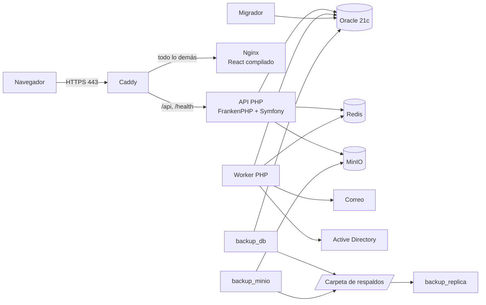
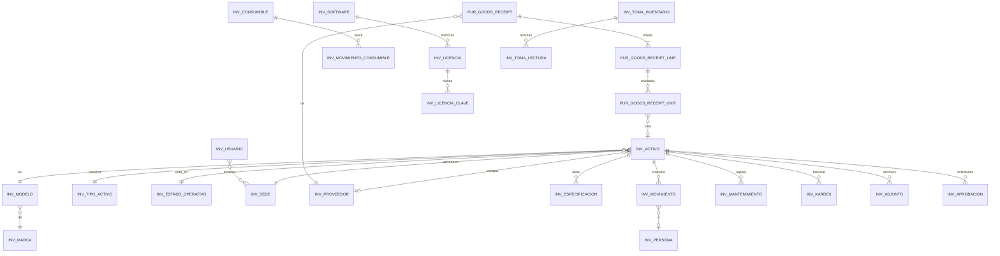
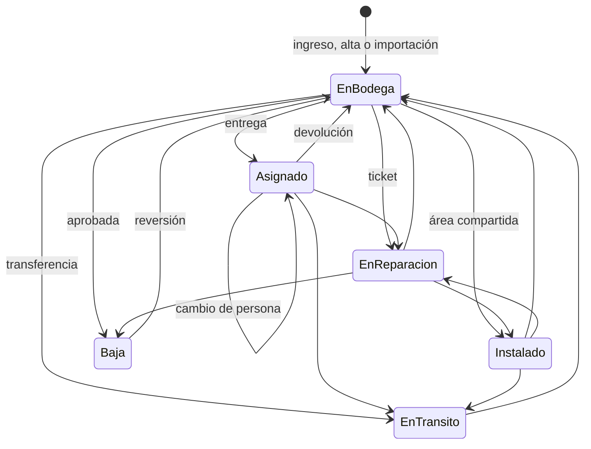
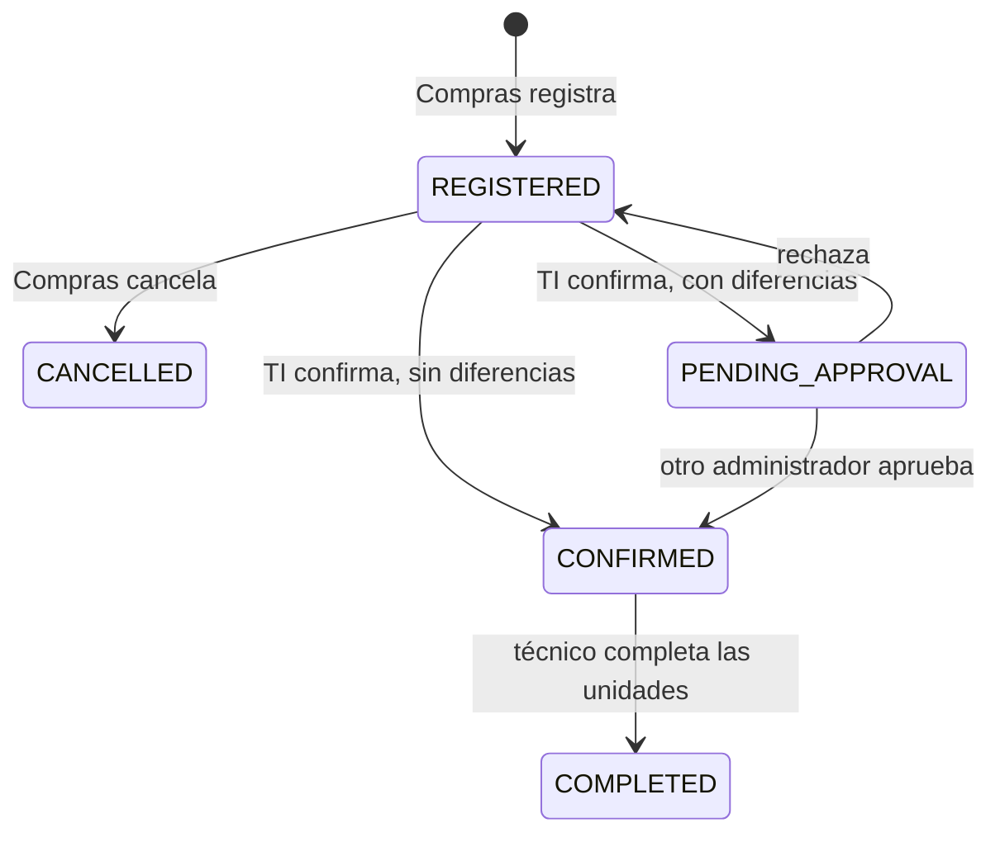

# Arquitectura de Inventario TI

Guía para entender el sistema, leer su código y operarlo. Para el uso diario está el [manual de operación](MANUAL_OPERACION.md); para los comandos básicos, el [README](../README.md).

## 1. Qué es

Controla los equipos de TI de la empresa durante toda su vida: entran por un **ingreso a bodega**, se entregan a una persona o se instalan en un área, pasan por mantenimiento, se cuentan en **tomas físicas** y salen con una **baja** aprobada. Cada cambio queda en un **kardex** que no se puede modificar. Cada mes, Contabilidad puede congelar un **cierre** con los valores.

Maneja tres clases de cosas:

| Clase | Se controla | Ejemplo |
|---|---|---|
| Activo | Una por una, con código y serie | Laptop, monitor, disco |
| Consumible | Por cantidad y costo promedio | Tóner, cables |
| Licencia | Por cupos y claves cifradas | Office, antivirus |

## 2. Reglas que explican casi todo

1. **Nada entra sin validar.** Compras registra lo que llegó y TI lo cuenta y confirma. Hay dos excepciones, ambas del administrador de TI: *Nuevo activo* (equipos sin factura) e *Importar Excel* (solo hasta el primer cierre mensual).
2. **Nadie aprueba lo que pidió.** Bajas, ajustes de stock, diferencias de un ingreso y reclasificaciones se piden y otra persona las aprueba. Por eso hacen falta dos administradores de TI.
3. **Cada rol ve solo lo que trabaja.** Lo que no puede hacer no se le muestra, y el servidor responde 403 de todas formas.
4. **La seguridad está en dos capas.** La aplicación filtra por sede y Oracle vuelve a filtrar con VPD, aunque la consulta tenga un error.
5. **El historial no se reescribe.** El kardex, la auditoría y el cierre mensual solo aceptan inserciones.
6. **Nada se borra.** «Eliminar» archiva el registro con su historial (borrado lógico); la base rechaza el borrado físico.
7. **Cada escritura se aplica una sola vez.** Dos personas a la vez, un doble clic o un reintento tras un corte no duplican ni pisan nada (ver [Concurrencia](#concurrencia-e-idempotencia)).

## 3. Piezas y cómo se conectan



| Servicio | Qué hace | Si se cae | Memoria máx. |
|---|---|---|---|
| `caddy` | Única puerta de entrada: HTTPS, cabeceras de seguridad y reparto de peticiones | Nadie entra | 256 MB |
| `frontend` | Nginx sirve los archivos de React | No carga la página; la API sigue viva | 256 MB |
| `api_php` | Toda la lógica de negocio | La página abre, pero no funciona | 1 GB |
| `worker_php` | Tareas de fondo: correos, purgas, alertas, AD | Se acumulan los correos; no se pierden | 512 MB |
| `oracle` | Todos los datos | Sistema detenido | 3 GB |
| `redis` | Memoria temporal: límites de peticiones, caché de sesión y cerrojos | Funciona más lento y con límites locales; no guarda datos de negocio | 256 MB |
| `minio` | Archivos adjuntos (facturas, fotos, actas) | No se suben ni se abren adjuntos | Sin límite |
| `minio_init` | Una vez al arrancar: crea el bucket, el versionado, el cifrado y el usuario | Bloquea el arranque de la API | — |
| `migrador` | Una vez al desplegar: migra la base e instala la seguridad | Aborta el despliegue a propósito | 512 MB |
| `backup_db` | Respaldo de Oracle cada hora | Se activa una alerta | 512 MB |
| `backup_minio` | Copia cada adjunto al subirse | Se reintenta con una copia completa | 256 MB |
| `backup_replica` | Copia los respaldos a otro disco o remoto | Sin copia externa; se activa una alerta | 256 MB |

**Redes de Docker:**
- `internal`, sin salida a Internet: Oracle, Redis, MinIO, migrador y respaldos.
- `salida`: Caddy y Nginx.
- La API y el worker están en las dos: necesitan los datos y también SMTP, AD y SSO.
- Solo Caddy publica puertos (80 y 443).

**Dos usuarios de Oracle:**
- `INVENTARIO` es el dueño del esquema; lo usan el migrador y los respaldos.
- `INVENTARIO_APP` lo usan la API y el worker. Solo lee y escribe filas: no puede cambiar tablas, políticas VPD ni disparadores.

## 4. Integraciones: qué hacen y cómo se gestionan

Los comandos de esta sección se ejecutan desde `backend/` en Git Bash. Antes, en Git Bash, conviene `export MSYS_NO_PATHCONV=1`.

Después de cambiar un valor de `deploy/.env`, aplique con `bash herramientas/desplegar.sh`: reinicia lo necesario y antes hace un respaldo verificado.

### Caddy (la puerta de entrada)

**Archivo:** `backend/deploy/Caddyfile`.

**Qué hace:**
- Obtiene y renueva el certificado HTTPS. Con `TLS_EMISOR=internal` (por defecto) lo emite su CA privada; con un correo en `TLS_EMISOR` y un dominio público, Let's Encrypt.
- Agrega cabeceras de seguridad como HSTS y `X-Frame-Options`.
- Reparte: `/api/*` y `/health` van a la API, y lo demás a Nginx.
- Bloquea desde afuera `/metrics` y `/health/full` con un 403.
- Pasa la IP real del cliente en `X-Real-IP`; de ella dependen los límites de peticiones y la auditoría.

| Tarea | Cómo |
|---|---|
| Cambiar la dirección del sitio | `DOMAIN`, `BACKEND_CORS_ORIGINS`, `FRONTEND_BASE_URL` y `TLS_DEFAULT_SNI` en `deploy/.env` ([puesta en marcha](PUESTA_EN_MARCHA.md#4-configuración)); con Let's Encrypt, además los puertos 80 y 443 abiertos a Internet |
| Aplicar un cambio del Caddyfile | `bash herramientas/desplegar.sh recargar` (sin cortar conexiones) |
| Ver el acceso y los errores | `docker logs inventario-caddy-1 --tail 100` |
| Entrar por IP | `TLS_DEFAULT_SNI=<ip>`: quien entra por IP no envía nombre y Caddy necesita saber qué certificado usar |
| Usar la CA privada (red interna) | Con un nombre interno o una IP, Caddy emite el certificado con su propia CA («Caddy Local Authority», raíz válida 10 años) y lo renueva solo. Exporte la raíz con `docker exec inventario-caddy-1 cat /data/caddy/pki/authorities/local/root.crt > caddy-root.crt` e instálela en los equipos como entidad raíz de confianza (por GPO); así el navegador deja de avisar |

Los certificados viven en el volumen `inventario_caddy_data`. No lo borre: con Let's Encrypt, repetir la emisión puede toparse con su límite.

### Nginx (la interfaz)

**Archivos:** `frontend/nginx.conf` y `frontend/Dockerfile`.

**Qué hace:** solo sirve los archivos compilados de React. No conoce la API.
- Los archivos con hash (`*.js`, `*.css`) se guardan un año en el navegador: cada versión tiene otro nombre.
- `index.html` nunca se guarda, para que siempre cargue la última versión.
- Cualquier ruta desconocida devuelve `index.html`, y React decide qué mostrar.
- Aplica la política de contenido (CSP) que limita de dónde pueden venir los scripts.

**¿Por qué Caddy y Nginx?** Caddy resuelve HTTPS y el reparto; Nginx viene empaquetado dentro de la imagen de la interfaz. Un cambio en `nginx.conf` requiere reconstruir la imagen: `bash herramientas/desplegar.sh`.

**Regla de Nginx que conviene conocer:** si un bloque `location` tiene su propio `add_header`, deja de heredar los del servidor. Por eso las cabeceras se repiten en cada bloque.

### FrankenPHP y Symfony (la API)

**Archivos:** `backend/docker/Dockerfile`, `backend/docker/Caddyfile` (el interno, no el del borde), `backend/docker/php.ini`.

FrankenPHP es un servidor de PHP en **modo worker**: mantiene Symfony cargado en memoria entre peticiones, y por eso responde rápido. Tiene una consecuencia para quien programa: **una variable o servicio con estado sobrevive a la petición**. Por ejemplo, el contexto VPD se limpia al terminar cada petición y otra vez al empezar la siguiente (`Db/ContextoRls.php`).

| Tarea | Cómo |
|---|---|
| Cambiar el número de hilos | `FRANKENPHP_WORKERS` en `deploy/.env.php` |
| Ver los logs (JSON, con `request_id`) | `docker logs inventario-api_php-1 --tail 100` |
| Comprobar el estado | `bash herramientas/desplegar.sh estado` |
| Listar todas las rutas | `docker exec inventario-api_php-1 php bin/console debug:router` |

### Oracle 21c XE (los datos)

**Archivos:** `backend/api/migrations/` (estructura), `backend/api/src/Esquema/` (seguridad), `backend/deploy/oracle/`.

XE es gratuito y tiene límites: 12 GB de datos de usuario, 2 CPU y 2 GB de memoria para la base. No incluye Data Guard: la protección viene de los respaldos horarios y la réplica.

`oracle/vigilante.sh` es el proceso principal del contenedor: si la instancia muere, hace salir al contenedor para que Docker lo reinicie.

| Tarea | Cómo |
|---|---|
| Consultar (hágalo solo con `SELECT`) | `docker exec inventario-api_php-1 php bin/console dbal:run-sql 'SELECT COUNT(*) FROM "INV_ACTIVO"'` |
| Verificar migraciones y VPD sin cambiar nada | `bash herramientas/desplegar.sh esquema` |
| Respaldar ahora | `bash herramientas/desplegar.sh respaldar` |
| Ver si el kardex está íntegro | Menú *Trazabilidad*, o `GET /api/v1/inventario/kardex/verificar` |

Los nombres de tabla y columna antiguos llevan comillas y distinguen mayúsculas (`"INV_ACTIVO"."ACT_Codigo_Interno"`); los módulos nuevos no (`PUR_GOODS_RECEIPT.GRC_CODE`).

### Redis (memoria temporal)

**Archivo:** configurado en `backend/deploy/docker-compose.yml`.

Guarda tres cosas: contadores de límites de peticiones, una caché corta de autenticación y cerrojos para que una tarea no corra dos veces. **No persiste nada** (`--save ""`, `appendonly no`) y al llenarse descarta lo más viejo. Se puede reiniciar sin perder datos de negocio.

```bash
docker exec inventario-redis-1 sh -c 'redis-cli -a "$REDIS_PASSWORD" --no-auth-warning info memory | grep used_memory_human'
docker exec inventario-redis-1 sh -c 'redis-cli -a "$REDIS_PASSWORD" --no-auth-warning dbsize'
```

### MinIO (archivos)

**Archivos:** el servicio y `minio_init` en `docker-compose.yml`; el código en `backend/api/src/Adjuntos/`.

Es un almacén compatible con Amazon S3 que corre en el mismo equipo. La base guarda solo los datos del adjunto (`INV_ADJUNTO`), y el archivo va a MinIO. El navegador nunca habla con MinIO: la API revisa los permisos y entrega el archivo.

Lo que queda configurado:
- **Bucket privado:** `lombardi-adjuntos`.
- **Versionado:** un archivo borrado se puede recuperar durante 90 días (`MINIO_VERSIONS_RETENTION_DAYS`).
- **Cifrado en reposo:** con `MINIO_KMS_SECRET_KEY`. **Si se pierde esa clave, no se pueden leer los archivos.** Guárdela aparte de los respaldos.
- **Usuario de la API:** `MINIO_APP_USER`, limitado a ese bucket.

La consola web (puerto 9001) no está publicada a propósito. Se administra con `mc`, desde el contenedor de respaldo:

```bash
# Definir un alias y ver el uso (no imprime claves)
docker exec inventario-backup_minio-1 sh -c 'mc alias set l http://minio:9000 "$MINIO_ROOT_USER" "$MINIO_ROOT_PASSWORD" >/dev/null && mc du l/$S3_BUCKET'
# Versionado y cifrado
docker exec inventario-backup_minio-1 sh -c 'mc alias set l http://minio:9000 "$MINIO_ROOT_USER" "$MINIO_ROOT_PASSWORD" >/dev/null && mc version info l/$S3_BUCKET && mc encrypt info l/$S3_BUCKET'
```

### Worker (tareas de fondo)

**Archivos:** `backend/api/src/Tareas/`.

Es la misma imagen que la API, pero ejecuta `messenger:consume scheduler_tareas`.

| Tarea | Cada | Qué hace |
|---|---|---|
| `email_outbox` | 15 s | Envía la cola de correos, con reintentos |
| `close_inventory_counts` | 60 s | Termina los cierres grandes de tomas |
| `ad_sync` | 60 s | Revisa si toca sincronizar Active Directory (`AD_SYNC_INTERVAL_MINUTES`) |
| `operational_alerts` | 5 min | Revisa respaldos, disco, correo y tomas, y genera alertas |
| `security_housekeeping`, `purge_security` | 6 h | Limpia tokens, sesiones y datos vencidos |

Para ejecutar una a mano: `docker exec inventario-worker_php-1 php bin/console app:tareas:ejecutar <nombre>`.

### Actualización en vivo (Mercure)

**Archivos:** `backend/api/src/Realtime/`, `backend/docker/Caddyfile`, `frontend/src/api/liveUpdates.ts`, `frontend/src/hooks/useLiveRefresh.ts`.

Lo que cambia una persona lo ven las demás al instante, sin recargar la página.

- **Quién avisa:** al terminar con éxito cualquier escritura de la API (POST, PUT, PATCH o DELETE), ya confirmada la transacción, la API publica qué ruta cambió (por ejemplo `core/activos/…`). También avisan las tareas del worker que hicieron algo, como la sincronización con el AD. El aviso no lleva datos: cada navegador vuelve a pedir lo que muestra por la API, con sus propios permisos y su sede.
- **El hub:** Mercure, incluido en FrankenPHP (gratuito, sin servicio externo), atiende `/.well-known/mercure` dentro de `api_php`. Caddy le pasa esa ruta.
- **Quién escucha:** solo quien tiene sesión. La API entrega una cookie `HttpOnly` al iniciar sesión y en cada renovación. Esa cookie permite escuchar el tema general y el tema propio de la persona.
- **Tema propio:** cerrar las sesiones de alguien, cambiarle el rol o darle una excepción de MFA le llega a sus pestañas abiertas. Estas comprueban la sesión en el acto; si ya no vale, salen.
- **En el navegador:** cada pantalla que carga datos usa `useLiveRefresh(cargar)` o `useLiveTick()`. Varios avisos seguidos causan una sola recarga; en una pestaña oculta, la recarga espera a que vuelva a verse. Un formulario con cambios sin guardar no se pisa. Tras un corte de conexión, todas las pantallas recargan una vez.
- **Si el hub falla:** la escritura no se afecta (se registra `realtime.publish_failed`). El chequeo de sesión cada 30 s sigue funcionando como respaldo.
- **Clave:** `MERCURE_JWT_SECRET` en `deploy/.env` (la crea `generar_env.sh`).
- **Lecturas en memoria:** el navegador guarda hasta 60 s cada lectura de la API (`frontend/src/api/cache.ts`), así volver a una pantalla es instantáneo. Toda escritura propia y todo aviso en vivo la vacían, de modo que nunca se muestra un dato viejo después de un cambio. No se guardan `/me`, `/login` ni las descargas.

### Correo (SMTP o Microsoft Graph)

El código escribe en la cola `SYS_EMAIL_OUTBOX` **después** de confirmar la transacción, y el worker envía. Si el correo falla, reintenta (`OUTBOX_MAX_ATTEMPTS`) y el negocio no se detiene. Los códigos de un solo uso (MFA, recuperación de clave) no pasan por la cola, para no guardarlos.

Se configura en *Configuración* desde la aplicación, o con `SMTP_*` en `deploy/.env` como respaldo. **Hoy `SMTP_HOST` está vacío: no sale ningún correo.**

### Active Directory y SSO

**Código:** `backend/api/src/Directorio/` y `backend/api/src/Autenticacion/Sso.php`.
- **AD (LDAPS o StartTLS):** el administrador del sistema lo configura en *Directorio*; la cuenta de servicio se guarda cifrada. Sincroniza personas y puede desactivar las que ya no existen (`AD_SYNC_DEACTIVATE`).
- **SSO (Microsoft o Google):** se activa con `SSO_ENABLED` y `SSO_*`. Hoy está apagado.

### Respaldos

| Qué | Cómo | Pérdida máxima | Retención |
|---|---|---|---|
| Oracle | Data Pump (`.dmp`) cada hora, verificado por su log | 1 hora | Todos 48 horas; luego uno por día hasta 14 días |
| Adjuntos | `mc mirror --watch`, sin propagar borrados | Segundos | Todo |
| Réplica externa | `rclone copy` cada minuto, sin propagar borrados | — | 30 días |

Se guardan en `BACKUP_DIR`. **Hoy la réplica va a otro disco del mismo equipo:** si el equipo se pierde, se pierden los dos. Eso está en [pendientes](PENDIENTES.md).

**Restaurar Oracle (destructivo).** Desde `backend/deploy`, definiendo antes `D='docker compose -p inventario --env-file .env --env-file .env.php'`:

```bash
$D stop api_php worker_php
$D run --rm --no-deps --entrypoint /bin/bash -e CONFIRMAR=SI backup_db /backup/restaurar_db.sh inventario_AAAAMMDD_HHMMSS.dmp
$D up -d migrador api_php worker_php     # el migrador repone VPD y permisos
```

**Restaurar adjuntos:** `$D run --rm --entrypoint /bin/sh backup_minio /backup/restaurar_minio.sh`.

### Configuración y secretos

| Archivo | En Git | Contiene |
|---|---|---|
| `backend/deploy/.env` | **No** | Claves de Oracle, Redis, MinIO, cifrado, SMTP; dominio, carpeta de respaldos |
| `backend/deploy/.env.php` | **No** | `APP_SECRET`, `FRANKENPHP_WORKERS` |
| `backend/deploy/docker-compose.yml` | Sí | Servicios y la lista de variables con sus valores por defecto |
| `backend/api/.env` | Sí | Plantilla de desarrollo, sin secretos reales |

Variables que **no se pueden perder ni cambiar a la ligera:** `FIELD_ENCRYPTION_KEY` (claves de licencia e integraciones), `MINIO_KMS_SECRET_KEY` (adjuntos), `SECRET_KEY` y `HMAC_KEYS` (sesiones y huellas). Sin ellas, los datos cifrados no se pueden recuperar. Guárdelas en un gestor de contraseñas, fuera del equipo.

## 5. Cómo viaja una petición

Ejemplo: el administrador de TI confirma un ingreso.

```mermaid
sequenceDiagram
    participant F as React
    participant C as Caddy
    participant L as Listeners de Symfony
    participant GC as GoodsReceiptController
    participant S as GoodsReceiptService
    participant O as Oracle
    F->>C: POST /api/v1/goods-receipts/15/confirm + token
    C->>L: HTTPS terminado; agrega X-Real-IP
    L->>L: request id, límite de peticiones
    L->>O: valida token, usuario y sesión; fija el contexto VPD
    L->>GC: rol permitido según Autenticado
    GC->>S: datos validados y usuario
    S->>O: transacción: líneas, activos, kardex, auditoría
    O-->>S: VPD filtra por sede; disparador sella el kardex
    S-->>GC: resultado; correo a la cola tras el commit
    GC-->>F: JSON; se quitan los costos si el rol no los ve
```

Si algo falla, la API responde un **código**, no un texto: `{"detail": "SERIAL_NUMBER_ALREADY_EXISTS"}`. El frontend lo traduce con `api_errors.<CÓDIGO>` de `src/locales/*.json`. Por eso los códigos no se cambian sin actualizar las traducciones.

## 6. Seguridad

### Inicio de sesión

1. `POST /api/v1/login/access-token`: revisa la clave con bloqueo progresivo; si hay MFA, sigue en `/login/2fa/verify`.
2. Entrega un **access token** (JWT de 15 minutos), que el navegador guarda **solo en memoria**, y un **refresh token** en una cookie `HttpOnly`, que JavaScript no puede leer. Así, un XSS no puede robar el refresh.
3. Al vencer, `src/api/axios.ts` lo renueva sin que la persona lo note. Si un refresh ya usado se reutiliza, se trata como robo y se cierra la sesión.
4. Límites de sesión: 2 horas de inactividad y 12 horas en total (configurables).

**MFA:** lo exigen SUPER_ADMIN, ADMIN_SEGURIDAD y ADMIN_TI (`TWO_FACTOR_REQUIRED_ROLES`), y nadie lo puede apagar (`MFA_CAN_BE_DISABLED=false`). Tiene tres flexibilidades (`Security/Mfa/`):

| Flexibilidad | Cómo funciona | Configuración |
|---|---|---|
| Omitir una vez | En el primer ingreso, la pantalla de configuración ofrece *Omitir por esta vez*: esa sesión sigue sin MFA (con un aviso) y el siguiente ingreso lo exige, sin volver a ofrecerlo | `INV_USUARIO.USU_MFA_Omitido_En` |
| Excepción | El SUPER_ADMIN exime una cuenta hasta una fecha, con motivo, desde *Usuarios y accesos*. Queda en la auditoría | `MFA_EXEMPTION_MAX_DAYS` (30) |
| Recordar el equipo | Al ingresar el código, la persona marca *Recordar este equipo*: en ese navegador solo se pide la contraseña hasta que vence. Se anula al cambiar la contraseña o el secreto MFA, al cerrar todas las sesiones o desde *Seguridad de mi cuenta* | `MFA_REMEMBER_DAYS` (30); tabla `SYS_TRUSTED_DEVICE` |

### Roles

Están en `backend/api/src/Dominio/Roles.php`, con espejo en `frontend/src/utils/roles.ts`. El servidor decide; el frontend solo evita mostrar lo que fallaría.

| Rol | Hace | No hace |
|---|---|---|
| `SUPER_ADMIN` | Usuarios (crear, bloquear con motivo, desbloquear, desactivar), configuración, directorio, MFA | No ve datos de negocio |
| `ADMIN_SEGURIDAD` | Consulta cuentas y auditoría; cierra sesiones | No modifica cuentas ni ve negocio |
| `ADMIN_TI` | Todo el inventario, catálogos, aprobaciones, cierre | No aprueba lo propio |
| `TECNICO` | Confirma ingresos, completa series, movimientos, mantenimiento, tomas | No ve costos; no da de alta directa |
| `AUDITOR` | Lee inventario y auditoría | No modifica |
| `CONSULTA` | Lee inventario | No ve costos ni personas |
| `COMPRAS` | Registra ingresos, proveedores, stock, cierre, exportes | No opera el inventario |

**Cómo se declara en el código.** Se suman los dos atributos, el de la clase y el del método:

```php
#[Route('/api/v1/core')]
#[Autenticado(roles: Roles::LECTURA_EXISTENCIAS)]   // para leer el módulo
final readonly class CoreController
{
    #[Route('/activos', methods: ['POST'])]
    #[Autenticado(roles: Roles::ADMIN)]             // y además, para crear
    public function crear(Request $request): JsonResponse
```

### Alcance por sede (VPD)

Un usuario solo ve las sedes que tiene asignadas, salvo que tenga alcance global.

- **Capa 1, aplicación:** `Seguridad/Alcance.php` agrega el filtro a las consultas.
- **Capa 2, Oracle:** las políticas VPD (`Esquema/PoliticasVpd.php`) agregan el `WHERE` automáticamente. Un `SELECT` sin filtro tampoco ve otras sedes, y tampoco se puede escribir fuera de ellas.

Ambas leen el mismo predicado de `INV_VPD_PREDICADO`, así que no pueden diferir. **Al agregar una tabla con datos por sede hay que agregar su política.** `$this->alcance->elevado(...)` salta el filtro: úselo solo para reglas que deben ver todo, como comprobar una serie repetida.

### Otras protecciones

| Protección | Dónde |
|---|---|
| Costos ocultos a `TECNICO` y `CONSULTA` en cualquier respuesta | `EventListener/OcultarCostosListener.php` |
| Reintentos sin duplicar (`Idempotency-Key`) | `Http/IdempotencyListener.php`, `Db/IdempotencyCommitMiddleware.php` |
| Borrado lógico y bloqueo del borrado físico | `Db/LogicalDelete.php`, disparadores `TRG_BL_*` |
| Límites de peticiones por ruta (`#[Limite('30/minute')]`) | `EventListener/LimiteListener.php` |
| Cifrado de claves de licencia e integraciones | `Seguridad/CifradoCampos.php` |
| Celdas seguras en CSV y Excel (evita inyección de fórmulas) | `Documentos/CeldaSegura.php` |
| Validación del tipo real de un archivo subido | `Adjuntos/TiposArchivo.php` |

### Concurrencia e idempotencia

| Riesgo | Cómo se evita | Dónde |
|---|---|---|
| Dos operaciones sobre el mismo registro a la vez | La fila se bloquea (`SELECT … FOR UPDATE`) antes de leer su estado; varios activos se bloquean siempre en el mismo orden, sin interbloqueos | `Activos::bloquearEnOrden`, ingresos, tomas, licencias, consumibles, aprobaciones |
| Contadores (stock, cupos) | Actualización condicional (`… WHERE stock >= :n`) que falla si otro ya lo consumió | `Consumibles`, `Software` |
| Duplicados (serie, código, hostname, mes cerrado) | Índices únicos en la base | Migraciones |
| Foto del cierre mensual descuadrada | El cálculo corre en una transacción `READ ONLY` (todas las consultas ven el mismo instante, sin bloquear a nadie). Después, el cierre y su auditoría se guardan en una transacción corta, y la clave única del periodo deja pasar uno solo de dos cierres simultáneos. No se usa `SERIALIZABLE`: Oracle la aborta con ORA-08177 cuando otra sesión confirma un cambio en una fila que luego se escribe | `CierreMensual::cerrar` |
| Doble clic, reintento tras un corte | El frontend envía una `Idempotency-Key` en cada escritura y comparte las peticiones idénticas en curso. El servidor reserva la clave, marca `APPLIED` **en el mismo commit** de la operación y guarda la respuesta: un reintento recibe esa respuesta y nunca se ejecuta dos veces | `api/axios.ts`, `Http/IdempotencyListener.php` |

### Borrado lógico

Eliminar un registro de negocio (catálogos, ubicaciones, proveedores, consumibles, software, licencias, mantenimientos, adjuntos, kits) lo **archiva** con Oracle In-Database Archiving (`ROW ARCHIVAL`): la fila conserva sus datos y referencias, ninguna consulta la ve y los respaldos la guardan con su estado (`Db/LogicalDelete.php`). Si otro registro vigente lo usa, no se elimina (409). Lo que se iba con él en cascada se archiva también; los vínculos entre registros (sedes de un usuario, compatibilidades) se quitan. Durante una petición, un `DELETE` físico sobre esas tablas lo rechaza la base (`ORA-20006`). Para ver lo archivado como dueño: `ALTER SESSION SET ROW ARCHIVAL VISIBILITY = ALL`.

Quedan con borrado físico solo los datos técnicos que vencen (tokens, códigos de un solo uso, sesiones, claves de idempotencia, correos ya enviados), los vínculos que se reescriben al editar (renglones de un kit, compatibilidades, especificaciones permitidas) y la foto de perfil, que es un dato personal.

## 7. Modelo de datos

Son unas 80 tablas. Los prefijos dicen a qué pertenecen: `INV_` inventario, `SYS_` sistema, `PUR_` ingresos, `CAT_` reglas de catálogo, `TRC_` cierres.



| Grupo | Tablas | Para qué |
|---|---|---|
| Activos | `INV_ACTIVO`, `INV_ESPECIFICACION`, `INV_INSTALACION`, `INV_MODELO`, `INV_MARCA`, `INV_TIPO_ACTIVO` | La ficha de cada equipo y sus componentes |
| Custodia | `INV_MOVIMIENTO`, `INV_PERSONA`, `INV_DEPARTAMENTO` | Quién tiene cada activo |
| Ubicación | `INV_PAIS` → `INV_ESTADO` → `INV_MUNICIPIO` → `INV_SEDE` → `INV_EDIFICIO` → `INV_NIVEL` → `INV_AREA` | Dónde está |
| Ingresos | `PUR_GOODS_RECEIPT`, `_LINE`, `_UNIT`, `_EVENT` | Lo recibido y su historia |
| Consumibles | `INV_CONSUMIBLE`, `INV_MOVIMIENTO_CONSUMIBLE` | Stock y costo promedio |
| Software | `INV_SOFTWARE`, `INV_LICENCIA`, `INV_LICENCIA_CLAVE` | Cupos, claves y cuentas |
| Control | `INV_KARDEX`, `INV_KARDEX_SELLO`, `INV_APROBACION`, `INV_AUDITORIA_SISTEMA`, `TRC_MONTH_END_CLOSE` | Historial, aprobaciones, auditoría, cierres |
| Tomas | `INV_TOMA_INVENTARIO`, `INV_TOMA_LECTURA`, `INV_FALTANTE` | Conteo físico |
| Sistema | `INV_USUARIO`, `INV_USUARIO_FOTO`, `SYS_SESION`, `SYS_EMAIL_OUTBOX`, `SYS_CONFIGURACION`, `SYS_IDEMPOTENCY_KEY`, `SYS_OPERATIONAL_ALERT` | Cuentas y operación |

`INV_ORDEN_COMPRA` y `INV_RECEPCION` siguen en la base, vacías y sin uso, porque se retiró ese módulo (ver [pendientes](PENDIENTES.md)).

### Estados de un activo

Definidos en `Inventario/EstadosActivo.php`.



Aparte del estado, un activo puede estar **por completar** (`ACT_Pending_Completion`): entró por un ingreso y le falta la serie. Mientras tanto no se asigna ni se espera en una toma.

### Kardex con sello encadenado

`INV_KARDEX` registra cada entrada, salida y cambio. El disparador `TRG_KARDEX_SELLAR` calcula un hash de cada fila más el hash de la anterior, como una cadena. Si alguien altera una fila, incluso directamente en la base, la verificación lo detecta. La aplicación no puede actualizar ni borrar esas filas.

## 8. Flujos de negocio

### Entrada: ingreso a bodega



| Paso | Quién | Qué ocurre | Código |
|---|---|---|---|
| Registrar | Compras | Proveedor, factura, líneas, costo y archivo. Nada entra aún | `GoodsReceiptService::register` |
| Confirmar | TI | Cuenta y clasifica cada línea: activo, consumible, licencia o no inventariable. Crea activos *por completar*, suma stock y crea licencias | `::confirm` |
| Aprobar | Otro admin. | Solo si hubo diferencias | `::approveDifference` |
| Acta | Compras | Descarga el acta de recibido | `ActasController` |
| Completar | Técnico | Serie, especificaciones y etiqueta | `::completeUnit` |

**Excepciones:** *Nuevo activo* (`Activos::crear`) e *Importar* (`Importacion/ImportacionActivos.php`, cerrado con el primer cierre mensual).

### Vida del activo

| Flujo | Qué hace | Código |
|---|---|---|
| Entrega o préstamo | Registra custodio, cambia a Asignado, kardex y acta | `Inventario/Movimientos.php` |
| Devolución, transferencia | Cierra la custodia y cambia el estado | `Movimientos.php` |
| Salida de una persona | Devuelve en lote lo que tiene | `Movimientos.php`, `OperacionesLote.php` |
| Mantenimiento | Abrir pasa a En Reparación; cerrar devuelve a Asignado, Instalado o En Bodega según tenía | `Inventario/Mantenimientos.php` |
| Componentes | Instala un activo dentro de otro; al retirarlo vuelve a En Bodega | `Inventario/Instalaciones.php` |

### Salida: baja

1. El administrador solicita la baja (`Solicitudes.php`). No cambia nada todavía.
2. Otro administrador la aprueba en *Aprobaciones*.
3. `Aprobaciones.php` vuelve a validar y ejecuta `Activos::darDeBaja`. Si la operación ya no es válida, no se hace nada y sigue pendiente.

Para pérdida o robo no hace falta devolver antes: la custodia se cierra al aprobar.

### Control

| Flujo | Qué hace | Código |
|---|---|---|
| Toma física | Lee códigos; marca lo encontrado, lo que está en otra sede y lo que no apareció, que queda como faltante | `Inventario/Tomas.php`, `Faltantes.php` |
| Cierre mensual | Congela valores: saldo, altas, bajas, consumibles, licencias, mantenimiento. No se puede reabrir | `Inventario/CierreMensual.php` |
| Bandeja de pendientes | Lista lo que requiere atención según el rol | `Inventario/Reportes.php` (`atencion`) |
| Calidad de datos | Detecta inconsistencias | `Inventario/Productividad.php` |

## 9. Cómo leer el código

### Backend (`backend/api/src`)

```
Controller/     Puerta HTTP: rutas, permisos y validación de entrada. Sin lógica de negocio.
Inventario/     Reglas del inventario: Activos, Movimientos, Kardex, Tomas, Aprobaciones…
GoodsReceipt/   Módulo por capas: Domain, Application, Infrastructure. Es el modelo para código nuevo.
Seguridad/      Tokens, contraseñas, alcance y cifrado.
Autenticacion/  Sesiones, MFA y SSO.
EventListener/  Lo que pasa en cada petición: autenticación, límites, errores, costos.
Esquema/        Migrador, VPD, disparadores y permisos.
Db/             Conexión, transacciones y traducción de errores de Oracle.
Crud/, Catalogo/  Catálogos genéricos (marcas, tipos, etc.).
Documentos/     PDF, Excel, CSV, actas y etiquetas.
Correo/, Notificaciones/, Tareas/  Correos, reglas de aviso y tareas de fondo.
Adjuntos/       Archivos y su almacén.
Directorio/, Integracion/  Active Directory y configuraciones externas.
Operations/, Reporting/  Salud, alertas y reportes.
```

**Para seguir cualquier función:**

1. Busque la ruta: `grep -rn "'/activos'" backend/api/src/Controller`.
2. Lea en el `#[Autenticado]` quién puede usarla.
3. El método valida con `Entrada` y llama a un servicio (`$this->activos->crear(...)`).
4. En el servicio están las reglas: suele usar `transaccion->ejecutar`, SQL explícito, `kardex->registrar` y `gobierno->registrarAuditoria`.
5. Busque el código de error en `backend/api/tests/Integracion/`: las pruebas describen el comportamiento esperado.

**Convenciones:**
- SQL explícito con DBAL, sin ORM.
- Los errores se lanzan con `throw new ErrorApi(409, 'CODIGO')`.
- Los correos y efectos externos van en `alConfirmar`: no ocurren si la transacción se revierte.
- El código antiguo está en español (`Activos.php`); el nuevo, en inglés y por capas (`GoodsReceipt/`).

### Frontend (`frontend/src`)

```
App.tsx          Todas las rutas, con los roles de cada una.
router/          ProtectedRoute y navigation.ts (el menú).
features/<área>/ Una carpeta por área: páginas, diálogos y su servicio de API.
components/      Compartidos; components/ui/ es la base (DataTableShell, Dialog, DateField…).
api/             axios.ts (token y renovación), errors.ts, servicios comunes.
context/         Sesión, configuración, preferencias y espacio de trabajo.
hooks/           usePermissions, useCatalogo, useUnsavedChanges…
utils/           acciones.ts (qué acciones ofrece cada estado), roles.ts, fechas…
locales/         es.json, en.json, it.json.
types/           Tipos de la API.
```

**Para seguir una pantalla:**

1. Busque la ruta en `App.tsx` y abra el componente (`/ingresos` → `features/goods-receipts/GoodsReceiptsPage.tsx`).
2. Las llamadas están en el servicio de la carpeta (`goodsReceiptService.ts`).
3. El texto visible usa `t('clave')`: busque la clave en `locales/es.json`.
4. Los permisos salen de `usePermissions()`.

**Convenciones:**
- Importe `Dialog` de `components/ui/Dialog`: avisa antes de perder datos y se adapta al móvil.
- Toda fecha usa `DateField`, y toda tabla, `DataTableShell`.
- Todo texto nuevo va en los tres idiomas y sigue el [glosario](GLOSARIO.md).

### Cómo agregar algo

| Quiero… | Toque |
|---|---|
| Una columna | Migración nueva en `api/migrations/` y las consultas afectadas, en el mismo cambio |
| Una tabla por sede | Migración, permisos y política en `Esquema/PoliticasVpd.php` |
| Una ruta | Controlador con `#[Autenticado]`, servicio y prueba en `tests/Integracion/` |
| Una acción que requiere aprobación | `Solicitudes.php`, un `case` en `Aprobaciones.php` y `types/aprobaciones.ts` |
| Una página | Componente en `features/`, ruta en `App.tsx`, entrada en `navigation.ts` y textos en los tres idiomas |
| Una tarea periódica | Clase que implemente `TareaPeriodica` en `Tareas/` |

## 10. Trabajar con el sistema

Todo corre en Docker: en el equipo solo hace falta Docker y Git Bash.

| Tarea | Comando |
|---|---|
| Desplegar | `cd backend && bash herramientas/desplegar.sh` |
| Ver el estado | `bash herramientas/desplegar.sh estado` |
| Pruebas del backend en producción | `CONFIRMAR=SI bash herramientas/pruebas_produccion.sh`: detiene la API y el worker, hace un respaldo verificado y toma una huella de la base. Corre la suite con el VPD activo, restaura el respaldo, exige la misma huella y vuelve a levantar todo (unos 15 minutos sin servicio) |
| Sondeo de entradas | `SONDEO=SI` en el mismo ciclo: cada petición de la suite se repite cambiando un solo dato por uno inválido (letras en fechas y montos, fechas imposibles, números enormes, listas por texto, 5000 caracteres, caracteres de control, ids basura en la ruta y la consulta). Toda respuesta 500 y todo cambio aceptado con un dato inválido queda en `api/var/sondeo-entradas.jsonl`. Las fallas de la suite en este modo son esperables (el sondeo cambia el estado); la regresión se mide con el ciclo normal |
| Pruebas del backend | `bash herramientas/pruebas.sh` (Oracle real, en un contenedor aparte) |
| Una parte | `bash herramientas/pruebas.sh --filter ActivosTest` |
| Pruebas del frontend | `cd frontend && bash test-support/run.sh` |
| Análisis de PHP | PHPStan, en el CI de GitHub |
| Pruebas funcionales | En producción, con las cuentas de prueba por rol (`docs/PRUEBAS_POR_ROL.md`). Hay un solo entorno: no se levanta QA ni otra copia |

**Qué hace `desplegar.sh`:**
1. Respaldo verificado; si falla, se detiene.
2. Construye las imágenes de la API y del frontend.
3. Corre `migrador`; si el esquema no queda completo, se detiene sin arrancar la API.
4. Arranca todo y espera a que esté sano.
5. Hace una prueba de humo.

**Migraciones:** son irreversibles en la práctica: `Version20261106000000` (unir Disponible en En Bodega) no tiene marcha atrás. Para volver atrás, se restaura el respaldo del despliegue.

### Pruebas que existen

| Nivel | Dónde | Cuenta |
|---|---|---|
| Backend, unitarias e integración | `backend/api/tests/` | Más de 270, con Oracle real |
| Frontend | `frontend/src/**/*.test.*` | 41 |
| Funcionales | `docs/PRUEBAS_POR_ROL.md` | En producción, por rol |
| Resistencia | `backend/herramientas/resistencia.sh` | Concurrencia y durabilidad |

### Diagnóstico rápido

| Síntoma | Revise |
|---|---|
| La página no abre | `desplegar.sh estado`; `docker logs inventario-caddy-1` |
| Abre pero no carga datos | `docker logs inventario-api_php-1 --tail 100` y busque el `request_id` que muestra el error |
| 503 o error de Oracle | `docker logs inventario-oracle-1 --tail 100` |
| No salen correos | `SMTP_HOST`; `docker logs inventario-worker_php-1` y `SYS_EMAIL_OUTBOX` |
| Un adjunto no abre | `docker logs inventario-minio-1`; `mc du` |
| Una persona no ve un activo | Sedes de su usuario (VPD) antes que el rol |
| Alerta de respaldo | `docker logs inventario-backup_db-1`, `BACKUP_DIR/oracle/*.log` |
| Tras cambiar de red | La dirección nueva debe estar en `DOMAIN` y `BACKEND_CORS_ORIGINS` |

## Capas y sus dependencias

| Capa | Carpetas | Puede depender de |
|---|---|---|
| Entrega | `Controller`, `Http`, `EventListener` | Negocio y dominio. Nunca consulta la base |
| Negocio | El resto de `src/` (casos de uso) | Dominio y los puertos (interfaces) que ella misma define. No conoce HTTP ni SQL |
| Datos | `Repositorio`, `<módulo>/Infrastructure`, `Db`, `Esquema` | Implementa los puertos del negocio. Aquí vive todo el SQL de Oracle |
| Dominio | `Dominio`, `<módulo>/Domain` | Nada externo: valores y reglas sin framework |

- **Errores:** el negocio lanza `ErrorDominio` con un motivo (`MotivoError`: no encontrado, conflicto, inválido…) y el código estable que traduce el frontend. Solo `ErroresListener::estadoHttp` convierte el motivo en estado HTTP.
- **Datos:** cada módulo define su puerto en `<Módulo>/Puertos` (por ejemplo `Inventario/Puertos/Proveedores`) y la capa de datos lo implementa (`Repositorio/ProveedoresOracle`). Symfony enlaza la interfaz con su única implementación.
- **Vigilancia:** `tests/Unit/ArchitectureTest.php` lee las importaciones de todo `src/` y falla si un archivo nuevo mezcla capas. Los archivos que aún las mezclan están en `tests/Unit/architecture-baseline.php`; esa lista solo puede reducirse. Tras migrar un módulo: `php tests/Unit/architecture-baseline.php --write`.
- **Estado al 2026-11-12:** errores HTTP fuera del negocio en todo el sistema. Con SQL propio quedan 20 archivos de negocio (eran 62) y 10 de entrega (eran 15). Dos formas de sacar el SQL: las clases que mezclaban reglas y consultas usan un puerto o un almacén de la capa de datos (`Repositorio/*`, `<Módulo>/Infrastructure/*Store`, `ConsultasComunes`, `ConsultasDocumentos`); las que eran solo persistencia o consultas de lectura (kardex, reportes, sugerencias, secuencias, colas) se reubicaron enteras en `<Módulo>/Infrastructure`. Quien solo abría transacciones usa `Db/Transaccion`.
